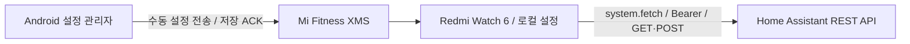

# Redmi Watch 6 · Home Assistant

중국 내수판 Redmi Watch 6용 Home Assistant 직접 제어 앱입니다. **Android는 설정 관리·XMS 동기화만 담당하며, 워치의 API 요청을 중계하지 않습니다.**

[설치 파일 / Releases](https://github.com/ug30242/homeassistant_rw6/releases) · [설치·설정 가이드](docs/setup.ko.md) · [실기기 검증표](docs/validation.ko.md) · [개발·서명](docs/development.ko.md)

## 구성



워치 설정 저장 후 Android 관리앱을 종료할 수 있도록 구현했습니다. Mi Fitness가 제공하는 네트워크 경로는 필요할 수 있습니다. 별도 서버·클라우드 중계·Android 상주 서비스는 없습니다.

**v0.1.3은 실기기 검증 전 사전 릴리즈입니다.** 중국 내수 펌웨어의 fetch/TLS/Authorization, Mi Fitness 왕복 통신, Android 강제 종료 후 동작은 실제 기기에서 확인해야 합니다. 자동 테스트 통과가 이를 증명하지는 않습니다. [검증표](docs/validation.ko.md)를 먼저 확인하세요.

## 기능

- Android 8.0 이상: 한국어 UI, 서버 연결 테스트, Keystore AES-GCM 암호화 저장, 엔티티 자동 조회·검색·도메인별 전체/선택 개수·다중 선택, 선택목록 전용 검토 화면에서 이름·아이콘·즐겨찾기·그룹·순서 편집.
- 워치 432×514: 큰 아이콘·종류·두 줄 이름의 즐겨찾기·전체·그룹 카드 목록. 카드 터치 후 상세화면에서 상태 조회·켜기/끄기·상세 제어·오류 표시. GET/POST 네트워크 테스트와 자격 증명 삭제. 기본 UI는 ASCII 영어이며 한글 이름은 entity_id 기반으로 대체합니다.
- `light`, `switch`, `fan`, `cover`, `sensor`, `scene`, `script` 지원. 센서는 읽기 전용, 밝기·커튼 위치·정지는 엔티티 기능 비트에 따라 표시합니다.
- 설정 최대 80개 / 48 KiB, 768바이트 단위 분할·ACK·재시도·CRC32·버전 검사. 전체 교체로 삭제를 반영하고, 이중 저장 슬롯과 읽기 확인 후에만 저장 완료 응답을 보냅니다.
- 메인 목록은 저장된 카드만 표시하며 상태 조회·자동 갱신·제어 요청을 하지 않습니다. 카드를 누른 상세화면에서 실제 상태를 조회하고 제어합니다. 선택한 30/60/120초 자동 갱신도 활성 상세화면에만 적용됩니다.
- Android `선택목록` 탭에서 전체 선택 항목과 워치 이름 미리보기를 확인하고, 이름·ID·그룹 검색 및 도메인·즐겨찾기 필터를 적용합니다. `즐겨찾기 · 워치 Favorites`를 변경한 뒤 `워치` 탭에서 전체 설정을 동기화합니다. 제어 결과를 확인하지 못하면 `unconfirmed`로 표시합니다.

## 설치 요약

1. 같은 릴리즈의 `rw6-ha-android-*.apk`와 `com.vela.rw6ha.release.*.rpk`를 받습니다.
2. APK를 Android에, RPK를 Notify for Xiaomi로 워치에 설치합니다. Mi Fitness와 워치 연결은 유지합니다.
3. Android에서 서버와 토큰 저장 → 연결 테스트 → 엔티티 조회·선택·편집.
4. 워치 `Sync` 화면을 열고 Android `워치` 탭에서 연결·권한 허용·동기화를 실행합니다.
5. **워치 저장 응답 확인** 후 워치 `Info`에서 GET/POST 테스트를 합니다. Android를 강제 종료하고 반복합니다.

APK와 RPK의 패키지는 모두 `com.vela.rw6ha`이며 같은 새 인증서로 서명합니다. 기존 `com.vela.rw6totp` 앱·서명·저장소와 독립적입니다. 서명 개인키는 Git에 포함하지 않습니다.

## 개발

Node 24, JDK 21, Android SDK 35 / Build-Tools 35.0.0을 사용합니다.

```sh
npm ci
npm test
npm run build
npm run smoke:rpk -- dist/com.vela.rw6ha.debug.0.1.3.rpk
cd android
./gradlew --no-daemon :app:assembleRelease :app:testReleaseUnitTest :app:lintRelease
cd ..
npm run test:interop
```

신규 버전의 서명된 설치 파일이 없으면 GitHub Secrets로 Actions에서 태그 소스를 직접 빌드·서명해 릴리즈합니다. APK/RPK를 로컬에서 만들거나 소스에 커밋할 필요가 없습니다. 빌드·서명·GitHub Secrets·자동 릴리즈 운영은 [개발 가이드](docs/development.ko.md)에 있습니다. 서명되지 않은 CI APK와 개발용 RPK는 릴리즈 설치 파일의 대체물이 아닙니다.

XMS·저장소·RPK 검증 코드의 출처와 실제 검증 범위: [TOTP 분석 기록](docs/reference-analysis.ko.md), [THIRD_PARTY_NOTICES.txt](THIRD_PARTY_NOTICES.txt).
