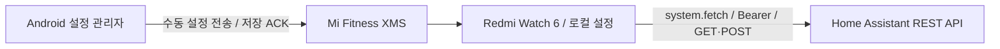

# Redmi Watch 6 · Home Assistant

중국 내수판 Redmi Watch 6용 Home Assistant 직접 제어 앱입니다. **Android는 설정 관리·XMS 동기화만 담당하며, 워치의 API 요청을 중계하지 않습니다.**

[설치 파일 / Releases](https://github.com/ug30242/homeassistant_rw6/releases) · [설치·설정 가이드](docs/setup.ko.md) · [실기기 검증표](docs/validation.ko.md) · [개발·서명](docs/development.ko.md)

## 구성



워치 설정 저장 후 Android 관리앱을 종료할 수 있도록 구현했습니다. Mi Fitness가 제공하는 네트워크 경로는 필요할 수 있습니다. 별도 서버·클라우드 중계·Android 상주 서비스는 없습니다.

**v0.1.2은 실기기 검증 전 사전 릴리즈입니다.** 중국 내수 펌웨어의 fetch/TLS/Authorization, Mi Fitness 왕복 통신, Android 강제 종료 후 동작은 실제 기기에서 확인해야 합니다. 자동 테스트 통과가 이를 증명하지는 않습니다. [검증표](docs/validation.ko.md)를 먼저 확인하세요.

## 기능

- Android 8.0 이상: 한국어 UI, 서버 연결 테스트, Keystore AES-GCM 암호화 저장, 엔티티 자동 조회·검색·도메인 분류·다중 선택, 이름·아이콘·즐겨찾기·그룹·순서 편집.
- 워치 432×514: 즐겨찾기·전체·그룹 목록, 켜기/끄기, 상세 제어, 상태 재조회, 마지막 갱신·오류 표시, GET/POST 네트워크 테스트, 자격 증명 삭제. 기본 UI는 ASCII 영어이며 한글 이름은 entity_id 기반으로 대체합니다.
- `light`, `switch`, `fan`, `cover`, `sensor`, `scene`, `script` 지원. 센서는 읽기 전용, 밝기·커튼 위치·정지는 엔티티 기능 비트에 따라 표시합니다.
- 설정 최대 80개 / 48 KiB, 768바이트 단위 분할·ACK·재시도·CRC32·버전 검사. 전체 교체로 삭제를 반영하고, 이중 저장 슬롯과 읽기 확인 후에만 저장 완료 응답을 보냅니다.
- 메인화면은 최근 상태를 즉시 표시하고 필요한 항목을 최대 2개씩 백그라운드 조회합니다. 재진입·필터 전환 시 갱신 주기(수동이면 30초) 내 조회 결과를 재사용하며, Refresh는 즉시 재조회합니다. 각 항목의 `Checked` 시각과 실패 시 `STALE` 표시로 과거 값을 구분합니다. 선택 시 활성 목록 화면에서만 30/60/120초 갱신하며, 갱신 중에도 화면 이동·제어가 가능합니다. 서버 푸시 방식의 실시간 수신은 지원하지 않습니다.
- Android `엔티티` 탭의 선택 목록에 있는 `즐겨찾기 · 워치 Favorites` 체크박스로 즐겨찾기를 변경한 뒤 `워치` 탭에서 전체 설정을 동기화합니다. 제어 후 실제 상태를 조회하며 확인할 수 없는 결과는 `unconfirmed`로 표시합니다.

## 설치 요약

1. 같은 릴리즈의 `rw6-ha-android-*.apk`와 `com.vela.rw6ha.release.*.rpk`를 받습니다.
2. APK를 Android에, RPK를 Notify for Xiaomi로 워치에 설치합니다. Mi Fitness와 워치 연결은 유지합니다.
3. Android에서 서버와 토큰 저장 → 연결 테스트 → 엔티티 조회·선택·편집.
4. 워치 `Sync` 화면을 열고 Android `워치` 탭에서 연결·권한 허용·동기화를 실행합니다.
5. **워치 저장 응답 확인** 후 워치 `Info`에서 GET/POST 테스트를 합니다. Android를 강제 종료하고 반복합니다.

APK와 RPK의 패키지는 모두 `com.vela.rw6ha`이며 같은 새 인증서로 서명합니다. 기존 `com.vela.rw6totp` 앱·서명·저장소와 독립적입니다. 서명 개인키는 Git에 포함하지 않습니다.

## 개발

Node 24, JDK 21, Android SDK 35 / Build-Tools 35.0.0을 사용합니다.

```sh
npm ci
npm test
npm run build
npm run smoke:rpk -- dist/com.vela.rw6ha.debug.0.1.2.rpk
cd android
./gradlew --no-daemon :app:assembleRelease :app:testReleaseUnitTest :app:lintRelease
cd ..
npm run test:interop
```

빌드·서명·GitHub Secrets·자동 릴리즈 운영은 [개발 가이드](docs/development.ko.md)에 있습니다. 서명되지 않은 CI APK와 개발용 RPK는 릴리즈 설치 파일의 대체물이 아닙니다.

XMS·저장소·RPK 검증 코드의 출처와 실제 검증 범위: [TOTP 분석 기록](docs/reference-analysis.ko.md), [THIRD_PARTY_NOTICES.txt](THIRD_PARTY_NOTICES.txt).
